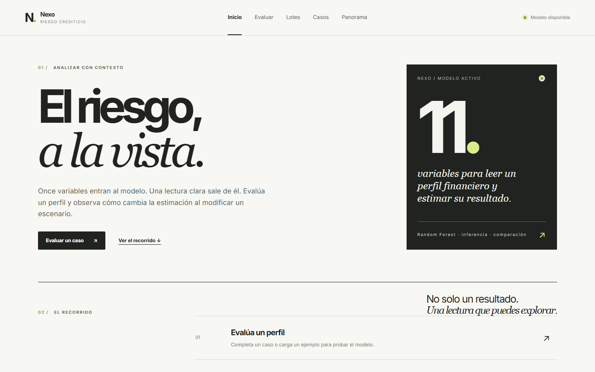
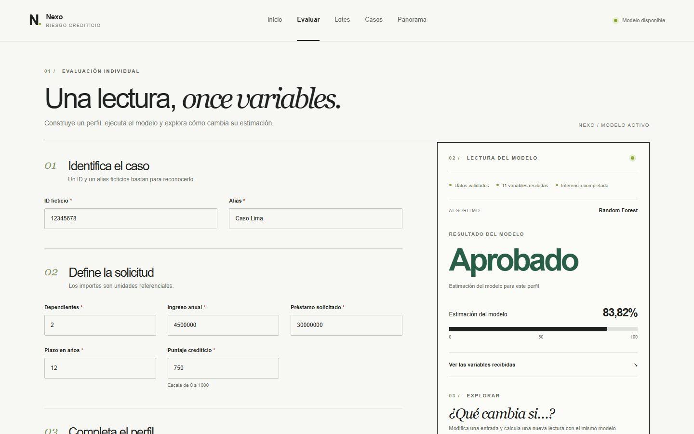
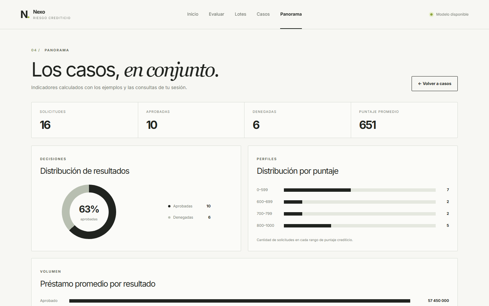
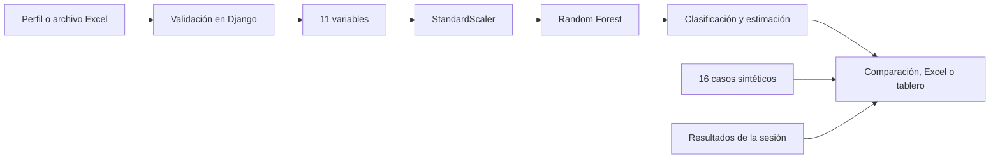

<div align="center">
  
  <h1>Nexo</h1>
  <p><strong>El riesgo, a la vista.</strong></p>
  <p>Una aplicación para evaluar perfiles crediticios, comparar escenarios y entender qué datos llegan al modelo.</p>
  <p>
    <a href="https://credit-risk-ml-29p9.onrender.com/">Abrir la aplicación</a>
    &nbsp;·&nbsp;
    <a href="https://credit-risk-ml-29p9.onrender.com/consulta_individual/">Probar una evaluación</a>
    &nbsp;·&nbsp;
    <a href="#ejecucion-local">Ejecutar localmente</a>
  </p>
</div>



Nexo convierte un formulario de evaluación en una experiencia que se puede explorar: muestra la lectura de un modelo de clasificación, permite cambiar una variable y vuelve a ejecutar la inferencia para comparar ambos resultados. La aplicación está [desplegada en Render](https://credit-risk-ml-29p9.onrender.com/) y puede probarse desde el primer momento con **16 casos sintéticos** y un caso precargado en el formulario.

## Pruébalo en un minuto

1. Entra en **Evaluar** y pulsa **Cargar ejemplo**.
2. Ejecuta **Evaluar solicitud** para ver la clasificación, la estimación y las 11 variables recibidas.
3. En **¿Qué cambia si…?**, modifica el préstamo, el plazo o el puntaje. La comparación llama de nuevo al modelo; no interpola una cifra en el navegador.
4. Guarda el resultado y abre **Casos** o **Panorama**. Verás tu consulta junto a los ejemplos durante esa sesión.

<details>
<summary><strong>Ver la evaluación y el tablero</strong></summary>

### Evaluación individual



### Panorama



</details>

## Qué puedes hacer

| Flujo | Experiencia |
| --- | --- |
| **Evaluación individual** | Introducir un perfil o cargar un ejemplo; consultar la clasificación, la estimación y los valores enviados al modelo. |
| **Comparación de escenarios** | Cambiar préstamo, plazo o puntaje y contrastar dos inferencias reales, incluida la diferencia en puntos porcentuales. |
| **Consulta por lotes** | Procesar hasta 10 casos desde un `.xlsx` de máximo 1 MB y descargar los resultados en Excel. |
| **Casos y panorama** | Filtrar evaluaciones y revisar gráficos calculados con los ejemplos y las consultas de la sesión. |

El botón **Ver reporte global** abre el tablero web incluido. Sus métricas se recalculan con las consultas del visitante; no dependen de Power BI.

## Cómo funciona el modelo

El artefacto serializado contiene una cadena de `StandardScaler` y `RandomForestClassifier`. Django valida los datos, construye las **11 entradas** esperadas y obtiene la clase predicha junto con la salida de `predict_proba` para la clase de aprobación. Al comparar un escenario, el servidor evalúa tanto el perfil original como el modificado; esa comparación no se guarda como una nueva solicitud.



<details>
<summary><strong>¿Cuáles son las 11 variables?</strong></summary>

Dependientes, ingreso anual, préstamo solicitado, plazo, puntaje crediticio, activos residenciales, activos comerciales, activos de lujo, activos bancarios, nivel educativo y condición de trabajador independiente. El ID y el alias sirven para identificar el caso en la interfaz; **no son entradas del modelo**.

</details>

La cifra mostrada es una **estimación del modelo**, no una probabilidad calibrada de incumplimiento ni una explicación causal. El comparador muestra cómo cambia la salida al variar una entrada; no atribuye causas a una decisión.

## Diseño técnico

| Capa | Tecnologías y función |
| --- | --- |
| Interfaz | Django Templates, HTML, CSS y JavaScript. Navegación, formulario, comparación y gráficos web. |
| Aplicación | Python 3.11 y Django 5.2. Validación, vistas, sesión y exportación. |
| Inferencia | scikit-learn, Pandas y NumPy. Pipeline serializado incluido en `ml_models/`. |
| Archivos | OpenPyXL para leer lotes y generar `.xlsx`. |
| Despliegue | Docker, Gunicorn y WhiteNoise; servicio público en Render. |

La versión pública **no usa SQL Server ni otra base de datos de solicitantes**. Empieza con 16 resultados sintéticos fijos; los resultados que guarda cada visitante viven durante una hora en una **cookie de sesión firmada**. La firma protege la integridad, pero no cifra el contenido: usa únicamente identificadores, alias y datos ficticios.

```text
interbank_loans/    Configuración y entrada WSGI de Django
loans/              Vistas, validación, inferencia, ejemplos y pruebas
ml_models/          Pipeline y orden de columnas serializados
templates/          Páginas de la aplicación
static/             Estilos, JavaScript, fuentes y plantilla Excel
docs/media/         Capturas de la interfaz actual
test/               Notebook del experimento original
Dockerfile          Imagen utilizada en el despliegue
```

<a id="ejecucion-local"></a>
## Ejecución local

Necesitas **Python 3.11**. Crea un entorno virtual nuevo: el directorio `venv/` antiguo procede de otra máquina y no forma parte de la instalación.

<details open>
<summary><strong>Windows · PowerShell</strong></summary>

```powershell
python -m venv .venv
.\.venv\Scripts\Activate.ps1
pip install -r requirements.txt
$env:DJANGO_DEBUG = "true"
python manage.py check
python manage.py test
python manage.py runserver
```

</details>

<details>
<summary><strong>macOS / Linux</strong></summary>

```bash
python3.11 -m venv .venv
source .venv/bin/activate
pip install -r requirements.txt
export DJANGO_DEBUG=true
python manage.py check
python manage.py test
python manage.py runserver
```

</details>

Abre `http://127.0.0.1:8000/`. No hace falta crear una base de datos ni ejecutar migraciones. Para probar lotes, descarga la [plantilla Excel](static/plantilla_lote.xlsx); conserva sus encabezados y usa `tecnico` o `secundaria` en `educativo`, y `si` o `no` en `autonomo`.

### Con Docker

```bash
docker build -t nexo .
docker run --rm -p 8000:8000 -e DJANGO_DEBUG=true nexo
```

Este comando inicia una instancia local de prueba. La imagen de producción ejecuta Gunicorn y sirve los archivos estáticos con WhiteNoise.

## Configuración de despliegue

| Variable | Uso |
| --- | --- |
| `DJANGO_SECRET_KEY` | Clave aleatoria privada; obligatoria cuando `DJANGO_DEBUG=false`. |
| `DJANGO_ALLOWED_HOSTS` | Nombre exacto del dominio público, sin `https://`. |
| `DJANGO_CSRF_TRUSTED_ORIGINS` | Origen HTTPS del servicio. |
| `DJANGO_DEBUG` | `false` en producción. |
| `DJANGO_TRUST_PROXY` | `true` solo si el proxy elimina encabezados `X-Forwarded-Proto` del cliente y establece el suyo. |
| `WEB_CONCURRENCY` | Número de trabajadores Gunicorn; `1` basta para una instancia pequeña. |

En Render, crea un **Web Service** desde el repositorio con entorno **Docker**. Configura los secretos y el dominio en las variables del servicio; la imagen escucha el puerto `PORT` proporcionado por la plataforma. Antes de publicar en otro entorno, ejecuta `python manage.py check --deploy` y aplica un límite de peticiones en el proxy para la inferencia pública.

<details>
<summary><strong>¿Y Power BI?</strong></summary>

El tablero que refleja las consultas de la sesión es el de la propia aplicación. Existe una integración **opcional**: `POWER_BI_EMBED_URL` puede insertar en Panorama un informe público de Power BI cuya URL empiece por `https://app.powerbi.com/view`. Ese informe es independiente y **no se sincroniza** con las consultas de cada visitante. No se distribuye ningún archivo `.pbix` con la imagen.

</details>

## Alcance del proyecto

Nexo es un proyecto personal de portafolio con identidad independiente de cualquier entidad bancaria. El modelo proviene de un dataset externo de aprobación de préstamos que incluye puntaje CIBIL; no está validado ni calibrado para solicitantes peruanos. Los importes se muestran como unidades referenciales y la aplicación está pensada para **datos ficticios**, no para decidir préstamos reales.

El [notebook original](test/ModeloPestamosPY001.ipynb) conserva el experimento de entrenamiento. Sus resultados de prueba no se presentan aquí como desempeño en población real. El dataset de origen no está incluido en el repositorio.

---

<div align="center">
  <strong>Diseñado y desarrollado por <a href="https://github.com/AlexDeRivia">AlexDeRivia</a>.</strong><br>
  <a href="https://credit-risk-ml-29p9.onrender.com/">Explorar Nexo</a>
</div>
